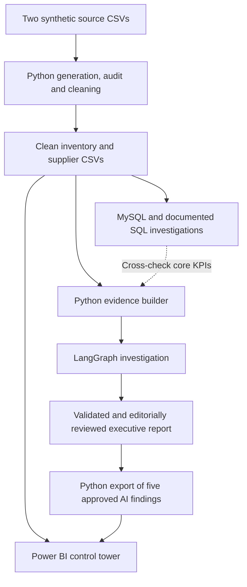
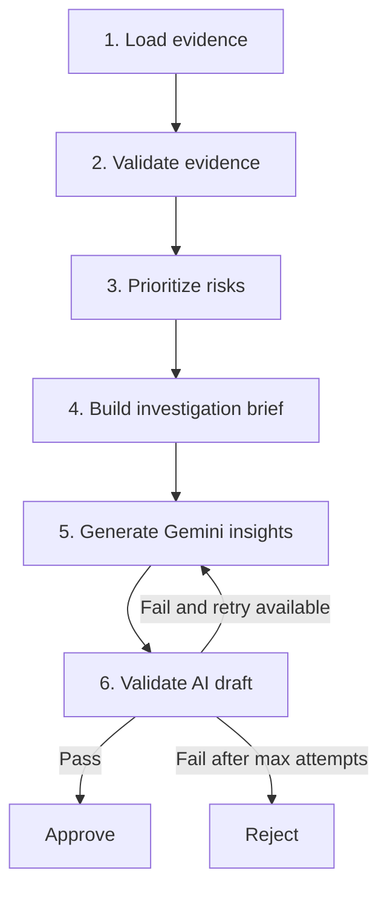
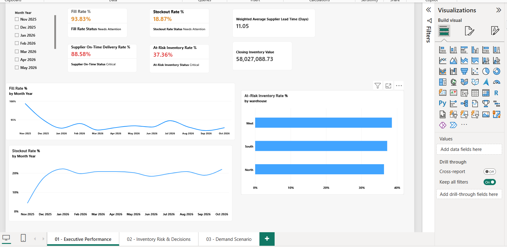
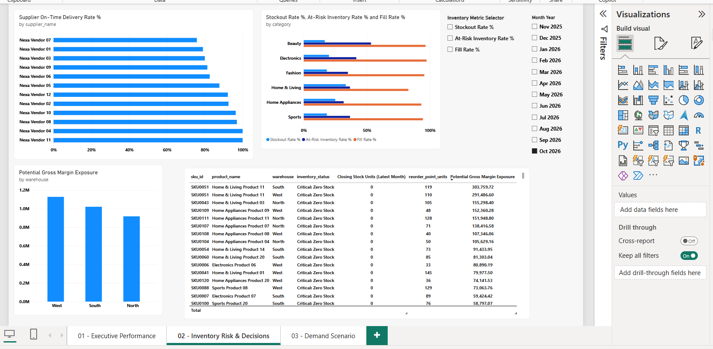
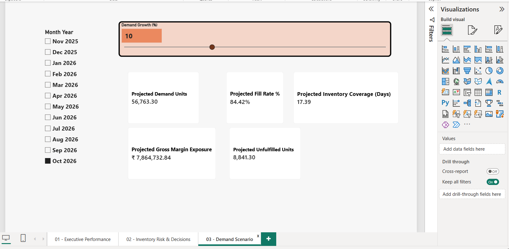
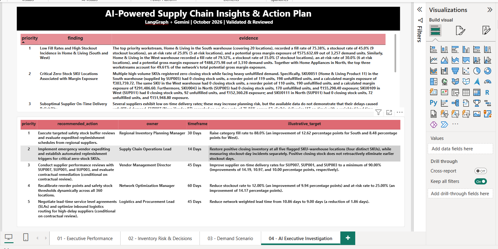

# Supply Chain AI Control Tower

**Business analytics portfolio project | Python · MySQL · Power BI · LangGraph · Gemini**

An end-to-end, reproducible supply-chain analytics case study that transforms intentionally messy, **synthetic** inventory and supplier data into an interactive Power BI control tower and an evidence-grounded executive investigation report. The AI workflow checks quantitative claims against deterministic calculations and routes invalid drafts for correction.

> **Data disclosure:** NexaDistribution is fictional. All data, supplier names, results, interventions, and financial figures are illustrative. Potential revenue and gross-margin exposure are **not realized losses**. This project demonstrates an analytical workflow; it is not a deployed enterprise system.

## At a glance

| Scope | Details |
|---|---|
| Reporting period | November 2025–October 2026 (12 months) |
| October 2026 snapshot | 120 SKUs · 3 warehouses (North, South, West) · 12 suppliers · 360 SKU–warehouse locations |
| Source datasets | `data/inventory.csv`, `data/suppliers.csv` (joined via `supplier_id`) |
| Clean analytical data | 4,320 monthly SKU–warehouse records · 12 supplier records |
| Analytics | Python data-quality pipeline, nine documented SQL files, four-page Power BI report (including a validated AI-insights page) |
| AI | Six-node LangGraph investigation with Gemini generation, numerical checks, conditional retry and bounded attempts |
| Final deliverable | [Validated and editorially reviewed executive report](output/gemini_investigation_approved.md) |

## Business problem

A distribution business must manage stockouts, low inventory coverage, unreliable supplier deliveries and potential margin exposure across warehouses. High-level averages can hide specific SKU–warehouse issues; an effective investigation needs traceable metrics, drill-down views and appropriately qualified recommendations.

**Business questions:** Where is demand going unfulfilled? Which warehouses, categories and SKUs warrant attention? How do supplier on-time reliability and *associated* financial exposure differ? Which operational changes are worth investigating, and how would success be measured?

## October 2026 KPI scorecard

| KPI | Verified result | Interpretation |
|---|---:|---|
| Customer demand | 51,603 units | Requested quantity |
| Fulfilled demand | 47,922 units | Supplied quantity |
| Unfulfilled demand | 3,681 units | Demand − fulfilled |
| Fill rate | **92.87%** | Fulfilled ÷ demand |
| Stockout rate | **21.94%** | 79 of 360 locations with one or more stockout days |
| At-risk rate | **39.17%** | 141 of 360 locations with positive closing stock below reorder point |
| Supplier on-time delivery | **88.61%** | 646 on-time of 729 eligible delivery lines |
| Weighted supplier lead time | **10.86 days** | Weighted average of eligible delivery observations |
| Closing inventory value | **₹58,027,088.73** | October month-end inventory, not a sum across months |
| Portfolio inventory coverage | **19.13 days** | Closing units ÷ estimated daily demand |
| Monthly inventory turnover | **1.45×** | Monthly COGS proxy ÷ average inventory value |
| Potential unmet selling value | **₹9,356,605.50** | Illustrative sales value linked to unfulfilled units |
| Potential gross-margin exposure | **₹3,071,205.83** | Unfulfilled units × (selling price − unit-cost proxy) |

Percentages are rounded. Supplier delivery lines are not necessarily distinct orders or shipments. The at-risk and stockout metrics have **different definitions** and should not be conflated with zero closing inventory.

### Selected business findings

- **Priority workstreams:** Home & Living / South had **75.38%** fill rate and **₹575,632.69** potential margin exposure; Home & Living / West had **79.52%** fill rate and **₹488,275.98** exposure; Home Appliances / North had **89.54%** fill rate and **₹459,738.32** exposure. Together they represented **49.61%** of network potential margin exposure.
- **High-risk SKU locations:** Two SKU0051 locations (South and West) accounted for **388 unfulfilled units** and **₹595,246.32** potential margin exposure. Across the top five ranked SKU–warehouse records, the **verified combined exposure was ₹1,054,853.80**.
- **Supplier trade-off:** SUP007 had **75.81%** on-time delivery across 62 eligible lines, while SUP005 was associated with **₹952,652.45** potential margin exposure despite **87.72%** on-time delivery. SUP011 had **100%** on-time delivery but **₹504,038.56** associated exposure. **Association is not evidence that a supplier caused unfulfilled demand.**
- **Month over month:** Fill rate improved from **92.09%** in September to **92.87%** in October (**+0.78 percentage points**), even as stockout rate increased from **18.89%** to **21.94%** (**+3.05 points**). Potential margin exposure fell by **₹1,082,972.51** month over month.

### Illustrative management scenario (not a forecast)

Holding October demand constant at 51,603 units, reaching a **95% fill rate** requires at least `ceil(51,603 × 0.95) = 49,023` fulfilled units—**1,101 additional units** over the baseline 47,922. Applying the existing average potential gross margin per unfulfilled unit (~₹834.34) suggests **approximately ₹9.19 lakh in potential margin opportunity**. This assumes the incremental units have a comparable product mix and margin, and that fulfillment can actually be improved; it is not guaranteed or realized financial benefit.

## Architecture



**LangGraph investigation:**



The workflow permits at most **two generation attempts**, checks **10 structured KPI values** and **11 detailed risk records**, applies currency rules, and preserves rejected outputs for local review. Automated validation verifies specified fields; **human review is still required for causal wording, assumptions and other unstructured narrative claims**. The final published report was **editorially reviewed and revalidated offline** after generation, with source evidence and earlier drafts retained locally.

## Power BI report

Open [`output/Supply_Chain_AI_Control_Tower.pbix`](output/Supply_Chain_AI_Control_Tower.pbix) in Power BI Desktop. The completed **four-page report** includes:

1. **Executive Performance:** network KPIs, monthly comparisons, and interactive business filters.
2. **Inventory Risk & Decisions:** inventory and supplier risk analysis with warehouse/category drill-down.
3. **Demand Scenario:** a demand-growth what-if slider for illustrative sensitivity analysis—not a forecast.
4. **AI Executive Investigation:** **five validated, editorially reviewed LangGraph + Gemini findings**, their numerical evidence and a proposed action plan (recommendations, owners, timelines and illustrative targets).

The implemented interaction features include month/warehouse/category/supplier slicers, cross-filtering, Field Parameters for metric selection, Year → Quarter → Month drill-down, and conditional KPI colours/statuses.

**How the AI output appears in Power BI:** `ai/12_export_ai_findings_for_powerbi.py` extracts structured finding fields from the approved Markdown investigation and writes `output/ai_findings_powerbi.csv`. Page 4 imports that CSV. This is a **fixed October 2026 investigation snapshot**, not live Gemini generation or an AI response that recalculates with report slicers. Its approval is based on numerical validation plus editorial review, and targets are illustrative.

### Dashboard screenshots

**Page 1 — Executive Performance**



**Page 2 — Inventory Risk & Decisions**



**Page 3 — Demand Scenario**



**Page 4 — AI-Powered Supply Chain Insights & Action Plan**



## Repository guide

| Path | Purpose |
|---|---|
| `data/` | Two generated raw CSVs containing deliberate data-quality defects |
| `python/generate_data.py` | Recreate the synthetic source data with a fixed seed |
| `python/audit_data.py` | Raw-data profiling and quality inspection |
| `python/clean_data.py` | Cleaning, correction logging and integrity checks |
| `sql/01_create_tables.sql` | Database/table setup |
| `sql/02_validate_import.sql` | Import and integrity validation |
| `sql/03_business_kpis.sql` | Core business metrics |
| `sql/04_monthly_trends.sql` | Monthly and month-over-month analysis |
| `sql/05_warehouse_analysis.sql` | Warehouse investigation |
| `sql/06_supplier_performance.sql` | Supplier performance investigation |
| `sql/07_inventory_risk_analysis.sql` | Inventory and reorder risk |
| `sql/08_financial_exposure.sql` | Financial exposure calculations |
| `sql/09_reconciliation.sql` | Reconciliation checks |
| `ai/01_build_evidence.py` | Build structured evidence for the AI investigation |
| `ai/02_langgraph_workflow.py` | Six-node Gemini + LangGraph workflow |
| `ai/12_export_ai_findings_for_powerbi.py` | Export five approved AI findings to Power BI-ready CSV |
| `ai/04_test_numerical_validator.py` – `ai/11_promote_reviewed_report.py` | Numerical, risk, routing, safeguard and report-approval tests/utilities; some require local review artifacts |
| `docs/business_requirements.md` | Scope, business questions and metric expectations |
| `output/inventory_clean.csv`, `output/suppliers_clean.csv` | Cleaned analytical tables |
| `output/ai_evidence_oct2026.json` | Structured October evidence |
| `output/langgraph_investigation_brief.json` | Investigation context used by the AI workflow |
| `output/gemini_investigation_approved.md` | Final reviewed executive report |
| `output/ai_findings_powerbi.csv` | Five approved AI findings imported into Power BI page 4 |
| `docs/screenshots/` | Four Power BI dashboard screenshots |
| `output/Supply_Chain_AI_Control_Tower.pbix` | Power BI report |

## Reproduce the workflow

**Prerequisites:** Python 3.13 (the tested environment), MySQL 8.x, DBeaver or another MySQL client, Power BI Desktop for the `.pbix`, and a Gemini API key **only if generating fresh AI commentary**.

From the repository root in PowerShell:

```powershell
python -m venv .venv
.\.venv\Scripts\Activate.ps1
python -m pip install -r requirements.txt
```

Generate, inspect and clean the synthetic data:

```powershell
python python/generate_data.py
python python/audit_data.py
python python/clean_data.py
```

Then create the MySQL schema with `sql/01_create_tables.sql`, import the two cleaned CSVs into their respective tables using DBeaver, run `sql/02_validate_import.sql`, and execute the analytical SQL scripts (`03`–`09`). **Do not import the intentionally defective raw CSVs for reporting.**

Build the AI input evidence:

```powershell
python ai/01_build_evidence.py
```

To generate a **new** Gemini investigation, place your API key in a local `.env` file using the environment-variable name expected by `ai/02_langgraph_workflow.py` (do not commit it), then run:

```powershell
python ai/02_langgraph_workflow.py
```

To rebuild the **fixed AI investigation snapshot for Power BI** from the checked-in reviewed report, run:

```powershell
python ai/12_export_ai_findings_for_powerbi.py
```

Then refresh the `ai_findings_powerbi` query in Power BI Desktop and save the `.pbix`. This refreshes the snapshot from the reviewed report; it does **not** call Gemini or automatically revalidate new AI-generated text.

Gemini outputs can vary between runs and may fail strict validation. Some offline tests and promotion utilities depend on locally retained draft/review files that are intentionally omitted from this public repository. The checked-in approved report is the curated, reviewed deliverable—not a promise that a fresh model run will reproduce identical wording.

## Data-quality safeguards and limitations

- The raw CSVs intentionally contain duplicates, missing values, formatting inconsistencies and impossible numeric values. The cleaned data was reduced from **4,355 to 4,320 inventory rows** and **14 to 12 supplier rows**, with **23 integrity checks passed**.
- The project relies on monthly synthetic observations rather than individual orders, customer outcomes, real purchase-order timestamps or transport-event logs. Observed correlations **do not prove operational root causes**.
- A stockout-day indicator, zero closing stock and positive closing stock below reorder point describe **different conditions**.
- On-time delivery has eligibility exclusions for unknown outcomes; exposure is an estimate using a unit-cost proxy.
- Supplier-associated financial exposure does not establish supplier culpability. Changes to safety stock, vendor policies or inter-warehouse transfers would require feasibility and business validation.
- The 95% fill-rate scenario assumes unchanged demand and an average per-unit margin; it is illustrative, not a statistical forecast.
- This is a portfolio demonstration with offline review controls, not a live integrated ERP/warehouse deployment.

## Skills demonstrated

**Business analysis:** BRD, KPI definitions, inventory and supplier risk triage, executive recommendations, limitations and quantified scenarios. **Data engineering and analytics:** Pandas, NumPy, MySQL, reconciliation, Power BI/DAX. **Applied AI:** LangGraph state machines, Gemini prompting, evidence-grounded generation, deterministic numerical validators, negative tests and bounded retry routing.

---

**Portfolio note:** All operational figures are derived from synthetic data. The report and dashboard are intended as an interview-ready demonstration of analytical reasoning, implementation and validation—not claims of real business savings.
